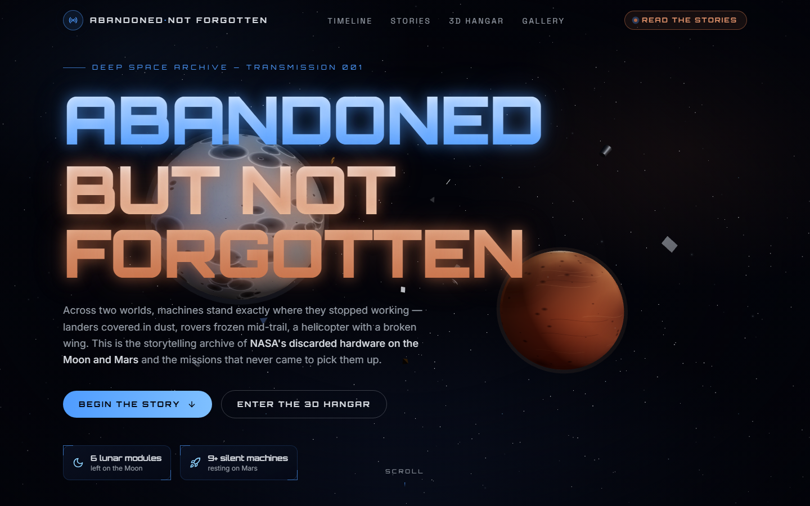
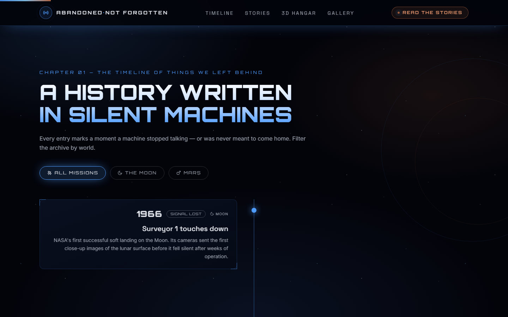
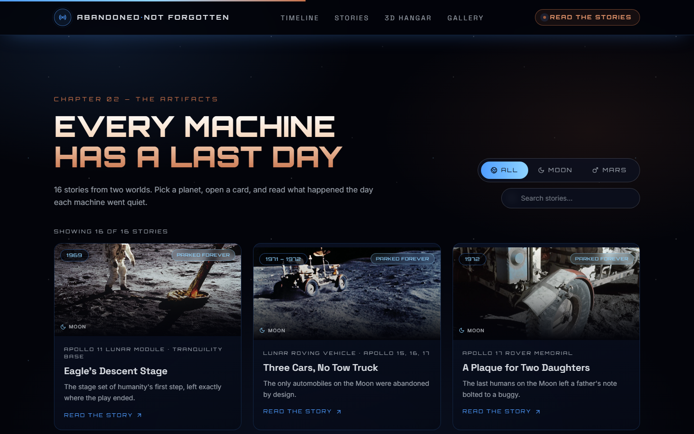
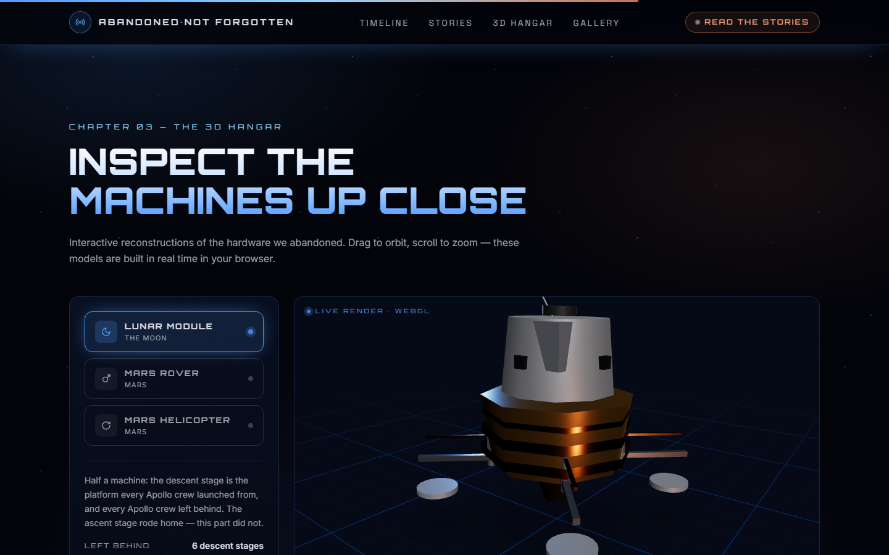
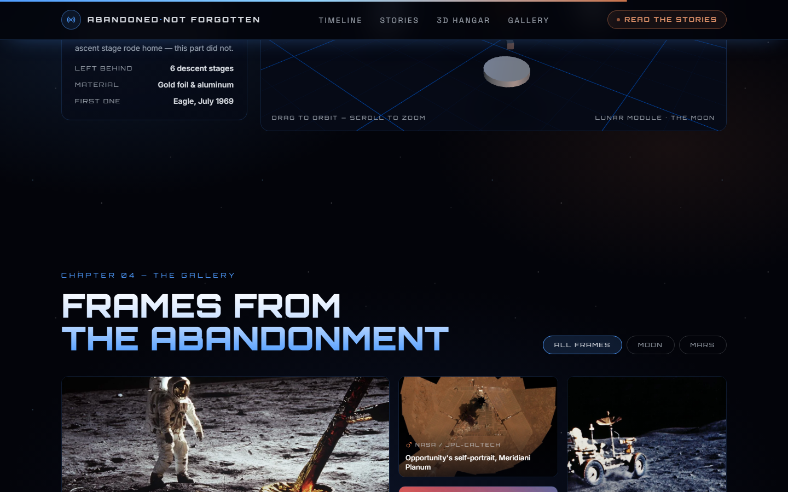
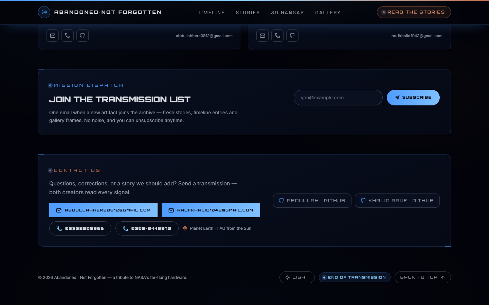
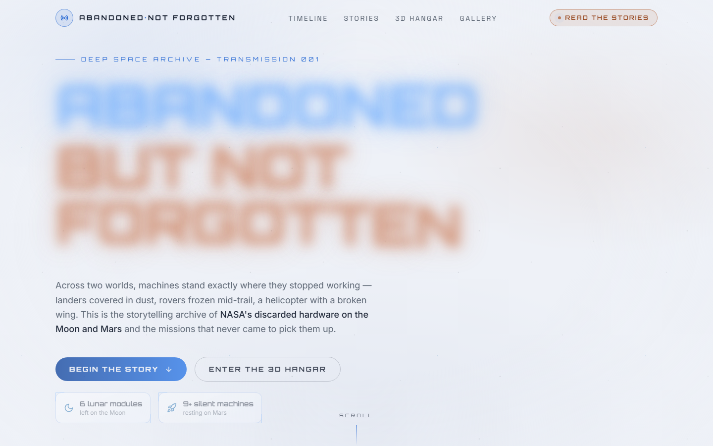

# Abandoned but not Forgotten

**NASA's discarded equipment on the Moon and Mars — a one-page storytelling site.**

Across two worlds, machines stand exactly where they stopped working: landers covered in dust,
rovers frozen mid-trail, a helicopter with a broken wing. This is the storytelling archive of
NASA's abandoned hardware and the missions that never came to pick it up.



---

## About

Every Apollo lunar module descent stage, every Mars rover, every lander that ran out of winter —
left behind not out of neglect, but out of mathematics: every kilogram climbed off the Moon is a
kilogram of margin for the crew's return. This site tells those stories — **16 stories across two
worlds, a 15-entry timeline, and a 12-frame gallery** of imagery from NASA's public archives.

## Features

- **Cinematic dark theme** with an animated three.js starfield, drifting debris, and a live Moon & Mars
- **Timeline** — 15 moments when machines went quiet, filterable by world (Moon / Mars)
- **Stories** — 16 in-depth stories with full-text search, All/Moon/Mars tabs, status badges and an accessible modal (keyboard navigation, focus trap)
- **3D Hangar** — interactive WebGL reconstructions of a Lunar Module, Mars rover and Mars helicopter (drag to orbit, scroll to zoom)
- **Gallery** — 12 NASA frames with filter chips and a keyboard-accessible lightbox
- **Light / dark theme toggle** — persisted, applied before first paint (no flash)
- **Newsletter** — "Mission dispatch" signup in the footer, persisted through the API
- **Accessibility** — skip link, focus-visible styles, `aria-pressed` filters, dialog semantics, `prefers-reduced-motion` support (verified programmatically)
- **SEO / social** — Open Graph + Twitter card meta, JSON-LD, generated 1200×630 share image
- **Performance** — three.js code-split out of the initial bundle (61.8 → 46 kB initial JS), offscreen WebGL paused, IntersectionObserver-based lazy mounting, WebP imagery (30% smaller than the source JPEGs)

### Screenshots

| Timeline | Stories |
| --- | --- |
|  |  |

| 3D Hangar | Gallery |
| --- | --- |
|  |  |

| Footer (newsletter + theme toggle) | Light mode |
| --- | --- |
|  |  |

## Tech stack

| Layer | Tech |
| --- | --- |
| Frontend | React 19 + Vite, Tailwind CSS v4, Framer Motion, lucide-react |
| 3D | three.js + @react-three/fiber + @react-three/drei |
| Backend | Node.js + Express (serves the API **and** the built site in production) |
| Content | Plain JS data module (`server/data.js`) — no database needed |
| Imagery | NASA Images API (`scripts/fetch-images.mjs`) → WebP conversion (`scripts/convert-images.mjs`, sharp) |

## Getting started

**Prerequisites:** Node.js 18+

```bash
# 1. install
npm install                # root (installs concurrently)
npm install --prefix client
npm install --prefix server

# 2. develop — API on :5001 (with --watch) + site on :5173
npm run dev

# 3. production build + serve (Express serves client/dist)
npm run build
npm start                  # http://localhost:5001
```

> In development the Vite dev server proxies `/api` to the Express API on port 5001.

## Project structure

```
NASA_App/
├── client/                 # React + Vite frontend
│   ├── public/
│   │   ├── images/         # 16 NASA photos (WebP)
│   │   └── og-cover.jpg    # social sharing image (1200×630)
│   └── src/
│       ├── components/     # Hero, Timeline, Stories, Gallery, ModelHangar, Footer…
│       ├── hooks/          # useApi, useFocusTrap, useTheme
│       ├── three/          # SpaceScene, procedural textures, 3D models
│       └── data/           # creators & contact details
├── server/
│   ├── data.js             # all content: 16 stories, 15 timeline, 12 gallery, stats
│   └── index.js            # Express API + static serving in production
├── scripts/                # image pipeline + headless-Chrome screenshot/probe helpers
└── docs/screenshots/       # images used in this README
```

## API

| Endpoint | Description |
| --- | --- |
| `GET /api/health` | Service heartbeat |
| `GET /api/stories` | All 16 stories (`?destination=moon\|mars` to filter) |
| `GET /api/stories/:id` | Single story |
| `GET /api/timeline` | Timeline entries |
| `GET /api/stats` | Hero stat counters |
| `GET /api/gallery` | Gallery frames |
| `POST /api/subscribe` | Newsletter signup — `{ "email": "you@example.com" }` |

## Content & imagery

Facts are drawn from NASA mission archives. All imagery is sourced from the
[NASA Images API](https://images.nasa.gov) and is in the public domain (credit retained
per frame in the gallery). This project is not affiliated with NASA.

## Creators

- **Abdullah** — [github.com/0x0Abdullah](https://github.com/0x0Abdullah) · [portfolio](https://0x0abdullah.github.io/)
- **Khalid Rauf** — [github.com/khalid1042](https://github.com/khalid1042)

## License

Released under the [MIT License](LICENSE).
